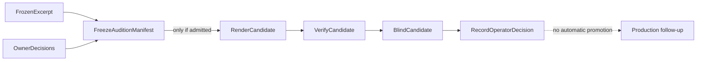

# OpenAI Stock-Voice Audition

## What This Module Owns

This candidate-local module owns the contract for preparing, rendering, verifying, blinding, and deciding one OpenAI stock-voice audition. It keeps provider capability, account authorization, empirical quality evidence, and the production owner's decision separate.

It does not own OpenAI's live interface, legal interpretation, account policy, the video script, public release, or implementation execution.

## Module Map

## Capabilities

| Capability | What | Key aspects |
|---|---|---|
| FreezeAuditionManifest | Convert frozen text, current provider contract, and explicit owner decisions into one immutable candidate. | `FreezeManifest`, `InspectManifest`, `AuditionManifest` |
| RenderCandidate | Submit the whole excerpt once for each of two repetitions and preserve raw response evidence. | `RenderCandidate`, `SpeechAPI`, `RenderAttempt` |
| VerifyCandidate | Check format, duration, exact spoken sequence, required phrases, and derivative provenance. | `VerifyCandidate`, `VerificationReceipt` |
| BlindAndDecide | Hide candidate identity, collect comparable score sheets, and preserve a human terminal decision. | `BlindCandidate`, `RecordOperatorDecision`, `OperatorDecision` |

## Domain Concepts

| Concept | Type | Key constraints |
|---|---|---|
| AuditionManifest | Entity | Immutable after admission; binds exact source, model snapshot, voice, accent/locale, request, account gates, tools, and owners. |
| FrozenExcerpt | Value Object | Exact bytes, SHA-256, UTF-8 counts, word count, and later exact route token count. |
| RenderAttempt | Entity | One unique repetition; raw bytes are append-only and never overwritten. |
| VerificationReceipt | Evidence Record | Separates technical/fidelity verdicts from subjective voice fit. |
| BlindScoreSheet | Evidence Record | Opaque candidate and repetition labels; fixed 1–5 weighted rubric. |
| OperatorDecision | Decision Record | Exactly `approve`, `reject`, or `defer`; named owner and governing hashes required. |
| AuditionState | State | `not_ready`, `admitted`, `rendered`, `verified`, `blinded`, `decided`, or `rejected`. |

## Concept Registry

| Concept | ID | Type |
|---|---|---|
| AuditionManifest | `openai-audition.AuditionManifest` | Entity |
| FrozenExcerpt | `openai-audition.FrozenExcerpt` | Value Object |
| RenderAttempt | `openai-audition.RenderAttempt` | Entity |
| VerificationReceipt | `openai-audition.VerificationReceipt` | Evidence Record |
| BlindScoreSheet | `openai-audition.BlindScoreSheet` | Evidence Record |
| OperatorDecision | `openai-audition.OperatorDecision` | Decision Record |
| AuditionState | `openai-audition.AuditionState` | State |
| FreezeManifest | `openai-audition.FreezeManifest` | Operation |
| RenderCandidate | `openai-audition.RenderCandidate` | Operation |
| VerifyCandidate | `openai-audition.VerifyCandidate` | Operation |
| BlindCandidate | `openai-audition.BlindCandidate` | Operation |
| RecordOperatorDecision | `openai-audition.RecordOperatorDecision` | Operation |
| InspectManifest | `openai-audition.InspectManifest` | Query |
| SpeechAPI | `openai-audition.SpeechAPI` | Interface |
| ManifestToSpeechRequest | `openai-audition.ManifestToSpeechRequest` | Mapping |

## Feature Concept Graph

| From | Edge | To | Evidence |
|---|---|---|---|
| `openai-audition.FreezeManifest` | produces | `openai-audition.AuditionManifest` | `OPERATIONS.md#freezemanifest` |
| `openai-audition.RenderCandidate` | consumes | `openai-audition.AuditionManifest` | `OPERATIONS.md#rendercandidate` |
| `openai-audition.SpeechAPI` | exposes | `openai-audition.RenderCandidate` | `INTERFACES.md#external-openai-speech-api` |
| `openai-audition.VerifyCandidate` | produces | `openai-audition.VerificationReceipt` | `OPERATIONS.md#verifycandidate` |
| `openai-audition.RecordOperatorDecision` | produces | `openai-audition.OperatorDecision` | `OPERATIONS.md#recordoperatordecision` |

## Non-negotiable invariants

1. `not_ready` is the initial state; only a complete immutable manifest can enter `admitted`.
2. The frozen excerpt is sent whole, unchanged, and in one request per repetition.
3. Exactly one stock voice/configuration is admitted; two scored repetitions use identical supported settings.
4. Custom and cloned voices are prohibited.
5. Undocumented controls are omitted, never guessed.
6. Credentials never enter source files, manifests, request previews, logs, filenames, hashes, or receipts.
7. Raw responses are append-only, uniquely named, hashed, and never overwritten.
8. A wrong unchanged-text pronunciation of “Body War” rejects this configuration because no documented correction route is bound.
9. Technical validity, fidelity, voice fit, legal/data gates, and operator decision remain separate verdicts.
10. Scores cannot auto-select, publish, promote, or authorize full narration.
11. Audience-facing use must disclose that the voice is AI-generated and not human.

## Acceptance

The module is implementation-ready only when the Design selection is a fixed-point pass, every SWU has an exact contract, and the Work Pack gate is `pass`. The present package intentionally keeps that gate blocked until the owner and account decisions in `WORK-PACK.md` are resolved.

## Aspect Docs

- [Operations](OPERATIONS.md)
- [Queries](QUERIES.md)
- [Interfaces](INTERFACES.md)
- [Mappings](MAPPINGS.md)
- [States](STATES.md)
- [Events](EVENTS.md)
- [Glossary](GLOSSARY.md)

## References

- [Source contracts](SOURCE-CONTRACTS.md)
- [OpenAI speech contract snapshot](OPENAI-SPEECH-CONTRACT.md)
- [Define context](DEFINE-CONTEXT.md)
