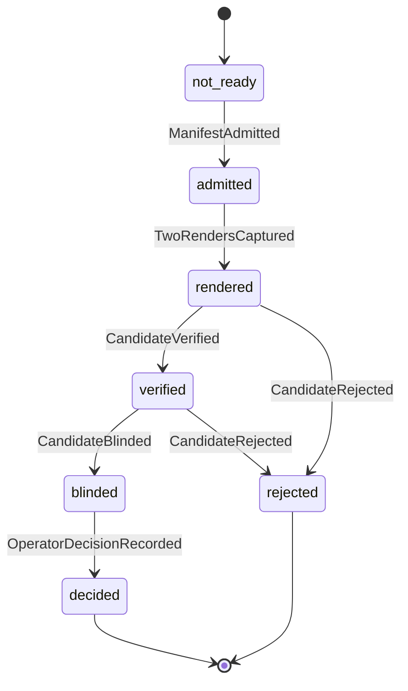

# State Machine: OpenAI Stock-Voice Audition

## Transition table

| From | Event | To | Guard | Effect |
|---|---|---|---|---|
| not_ready | ManifestAdmitted | admitted | Every hard gate closed; exact manifest digest current | Freeze manifest and admission receipt. |
| admitted | TwoRendersCaptured | rendered | Exactly two immutable identical-configuration attempts exist | Bind raw hashes and metadata. |
| rendered | CandidateVerified | verified | Technical and fidelity checks pass | Freeze verification receipt. |
| rendered/verified | CandidateRejected | rejected | Any disqualifier or unresolved mismatch | Record reason; no repair by silent regeneration. |
| verified | CandidateBlinded | blinded | Opaque assets, listener orders, and protected key exist | Open blind-listening lane. |
| blinded | OperatorDecisionRecorded | decided | Scores locked, key opened, named owner acts | Record `approve`, `reject`, or `defer`. |

## Invariants

| ID | Invariant |
|---|---|
| ST-1 | No state skips a predecessor. |
| ST-2 | A receipt proves only its own transition. |
| ST-3 | Any stale digest returns the candidate to `not_ready`; it does not auto-refresh. |
| ST-4 | `rejected` and `decided` are terminal for that manifest digest. A new configuration needs a new manifest ID. |
| ST-5 | This package's current state is `not_ready`. |
