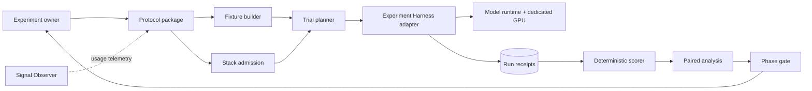
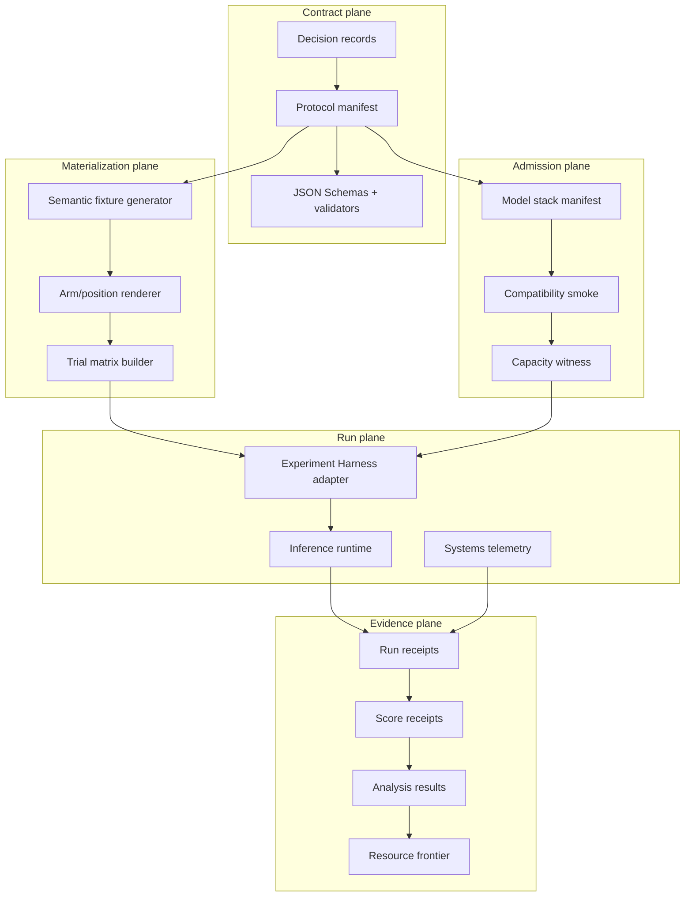
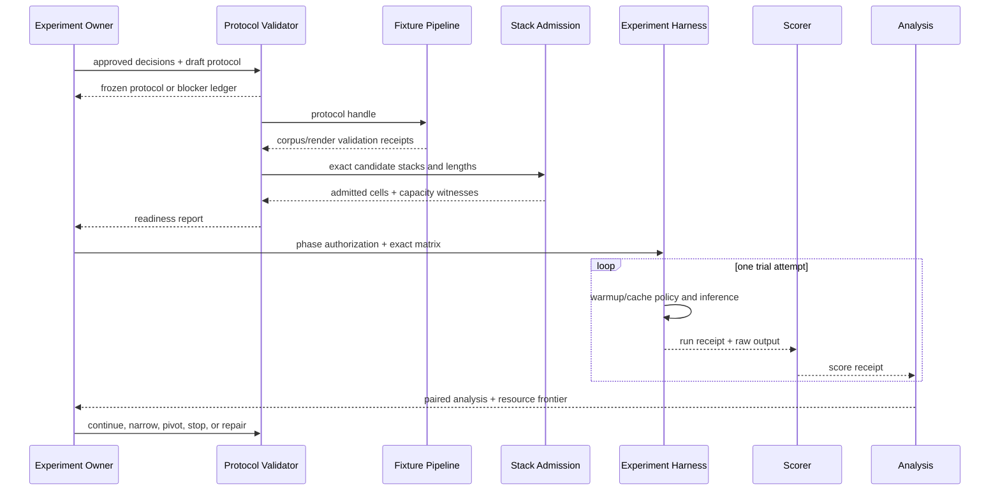
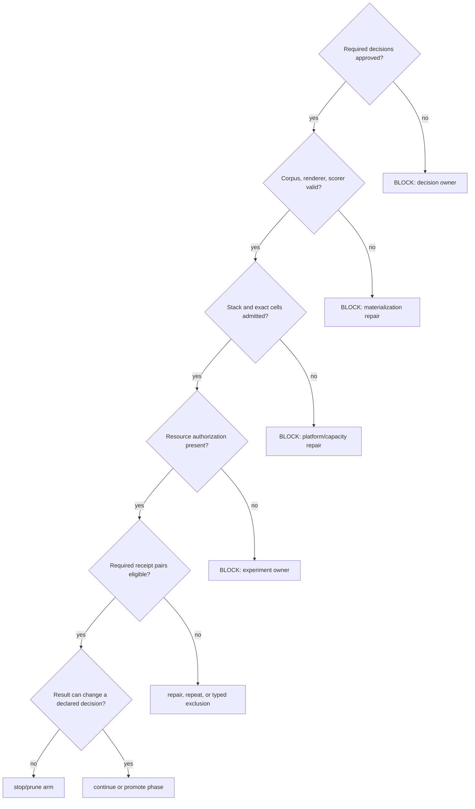

# Architecture Bundle: High-Attention, Low-Parameter Experiment Protocol

## Design Intent

Create a content-addressed, fail-closed experiment harness in which every claim
can be traced from a frozen protocol decision through fixture, prompt, stack,
run, score, and analysis receipts. Keep workload meaning, platform admission,
statistical inference, and budget promotion independently owned while joining
them through one typed trial-cell contract.

The architecture supports a stack-specific paired checkpoint experiment. It
does not create a generic benchmark service, model-training platform, or
production inference system.

## Source Contracts

- [Approved specification](SPEC.md)
- [Feature glossary](GLOSSARY.md)
- [Domain concepts](domain.md)
- [Operations](operations.md)
- [Queries](queries.md)
- [Interfaces](interfaces.md)
- [States](states.md)
- [Events](events.md)
- [Mappings](mappings.md)
- [Auditor-approved methodology](../experiment-protocol-research/findings.md)

## 1. Context View



Actors and boundaries:

- The experiment owner approves decisions, resources, and phase promotion.
- Invoke owns these authoring artifacts only.
- Task Session owns implementation of one SWU at a time.
- Experiment Harness owns repeatable run orchestration once readiness passes.
- Model/runtime owners retain checkpoint and platform authority.
- Inventory receives only explicit non-authority result backfills.

## 2. High-Level Structure View



The only cross-plane join key is a content-addressed protocol/fixture/cell/run
identity chain. No component may reconstruct a missing upstream decision from
convenience defaults.

## 3. Low-Level Component View

| Component | Responsibility | Inputs | Outputs | Failure boundary |
| --- | --- | --- | --- | --- |
| `protocol-validator` | Validate frozen decisions, factors, analysis, and gates. | protocol and decision records | readiness report | Any unresolved required decision blocks. |
| `fixture-generator` | Create deterministic semantic plans and family-level splits. | generator config, seed, provenance | fixtures JSONL, manifest | Non-determinism or provenance gap blocks corpus admission. |
| `prompt-renderer` | Produce arm/rotation bytes, token IDs, evidence spans, hashes. | fixture, arm, model template | render receipt | Overflow or template drift blocks cell. |
| `scorer` | Parse versioned grammar and score answer/evidence/support separately. | ground truth, raw output | score receipt | Parse/scorer failures remain typed results. |
| `stack-admitter` | Bind checkpoint/tokenizer/template/runtime/hardware and smoke compatibility. | stack candidate | immutable model-stack receipt | Missing hash/access/compatibility blocks stack. |
| `capacity-prober` | Prove resident-KV behavior for exact model/length cell. | model stack, render probe | capacity witness | Any prohibited fallback blocks the cell. |
| `matrix-builder` | Expand approved factors and pruning decisions into exact cells. | protocol, corpus, admitted cells | trial-matrix JSONL | Hidden defaults or unowned exclusions block. |
| `run-adapter` | Translate one admitted trial cell into Experiment Harness execution. | trial cell and manifests | raw output, run receipt | Always emits success/failure receipt. |
| `telemetry-capture` | Record prefill/decode/memory/energy within declared boundary. | runtime events | resource fields/receipt | Missing mandatory telemetry blocks analysis eligibility. |
| `analysis-runner` | Execute frozen paired estimands and multiplicity policy. | score/resource receipts | analysis result | Unpaired/missing cells follow exclusion policy. |
| `frontier-builder` | Compute non-dominance over named axes. | analysis/resource results | resource frontier | Never invents a composite primary score. |
| `readiness-reporter` | Project gates, blockers, evidence, and next owner. | all manifests/receipts | human + JSON status | Read model only; grants no authority. |

### Storage Layout

```text
experiment-protocol/
  configs/          frozen protocol and decision records
  schemas/          artifact schemas
  src/              deterministic builders, validators, scorer, analysis
  fixtures/         semantic plans, manifests, validation fixtures
  manifests/        model/runtime/hardware and phase manifests
  capacity/         per-model/length witnesses
  trials/           rendered cells and trial matrices
  runs/             immutable run receipts and raw outputs
  scores/           score receipts
  analysis/         analysis results and resource frontiers
  reports/          human projections
```

Generated run material may be large or sensitive and needs an explicit tracked,
ignored, or external evidence policy before implementation. The documentation
package does not decide that policy silently.

## 4. Workflow Process View



Ordering constraints:

1. Freeze precedes materialization.
2. Template-aware rendering precedes exact capacity admission.
3. Admission precedes queuing.
4. Every attempt produces a receipt before scoring.
5. Analysis eligibility precedes phase interpretation.
6. Phase evidence precedes promotion.

## 5. Decision Flow View



Decision precedence:

1. Safety/license/access and artifact validity.
2. Exact stack and capacity feasibility.
3. Confirmatory analysis integrity.
4. Value-of-information and resource frontier.
5. Optional extension breadth.

## 6. Dependency And Interface View

| Boundary | Contract | Direction | Owner | Validation |
| --- | --- | --- | --- | --- |
| Research -> protocol | findings and explorer handles | inbound | Invoke/spec owner | Typed KILLs and four ownership surfaces preserved. |
| Human -> protocol | decision records | inbound | experiment owner | Approval, alternatives, rationale, timestamp. |
| Protocol -> fixture | protocol schema | outbound | protocol owner | Schema + semantic validation. |
| Model source -> admission | immutable snapshot/template metadata | inbound | model owner | Access, hash, compatibility smoke. |
| Admission -> harness | model stack + capacity witness | outbound | platform owner | Exact cell admitted, no fallback. |
| Plan -> Task Session | one SWU handle | outbound | Invoke plan | Context-builder-ready source anchors and validation. |
| Trial -> Experiment Harness | exact trial-cell handle | outbound | experiment runtime owner | Frozen factors and manifests. |
| Harness -> evidence | run/resource receipt | outbound | Experiment Harness | Required receipt fields and raw output handle. |
| Evidence -> analysis | score/resource receipts | inbound | analysis owner | Pairing, eligibility, exclusion ledger. |
| Result -> Inventory | candidate synthesis | outbound | Inventory owner | Explicit backfill; non-authority status. |

## Design Decisions

| ID | Decision | Rationale | Consequence |
| --- | --- | --- | --- |
| HALP-ADR-001 | Use content-addressed file artifacts as the canonical experiment record. | Reproducibility and review do not require a service or mutable database. | Scale/remote orchestration is deferred. |
| HALP-ADR-002 | Keep four ownership modules joined by `TrialCell`. | Prevent workload, platform, inference, and budget concerns from silently deciding each other. | Cross-module schemas are load-bearing. |
| HALP-ADR-003 | Use deterministic procedural T0 fixtures first. | Isolates controlled behavior and enables exact scoring. | Realistic T1 corpora remain an extension, not proof of mechanism. |
| HALP-ADR-004 | Use a strict output grammar and deterministic scorer. | A qualitative judge would add an unbounded measurement system. | Judge-based scoring requires a separate validated decision. |
| HALP-ADR-005 | Adapt one-cell execution to `experiment-harness`. | Reuses repeatable run/receipt ownership without making Invoke an executor. | Harness adapter contract is required. |
| HALP-ADR-006 | Treat failure/infeasibility as first-class receipts. | Prevents survivorship and hidden systems substitutions. | Analysis must preserve missingness reasons. |
| HALP-ADR-007 | Defer live retrieval, Phi, realistic datasets, and 128K. | They add distinct systems/content questions before the primary within-family witness closes. | Later layers require explicit decision value. |
| HALP-ADR-008 | Separate all capability/resource axes. | A single score hides binding constraints and measurement boundaries. | Phase gate consumes a Pareto view plus declared deployment constraint. |

## Glossary Consistency

Status: pass. The architecture uses every domain term in the meaning fixed by
[GLOSSARY.md](GLOSSARY.md). Component names such as `matrix-builder` and
`capacity-prober` are implementation roles, not new governed domain concepts.
See [GLOSSARY-CONSISTENCY.md](GLOSSARY-CONSISTENCY.md).

## Risks And Design Gaps

| ID | Risk/gap | Impact | Owner / treatment |
| --- | --- | --- | --- |
| HALP-GAP-001 | Numeric thresholds and sample allocation are unapproved. | Blocks protocol freeze and analysis. | Human decision task. |
| HALP-GAP-002 | Exact checkpoint/template/runtime revisions are unknown. | Blocks model-stack admission. | Platform admission task. |
| HALP-GAP-003 | Tracked/ignored/external policy for large run evidence is unset. | Blocks durable receipt implementation. | Repository owner decision. |
| HALP-GAP-004 | Energy/cost measurement boundary is unset. | Blocks resource-frontier claim. | Experiment owner decision. |
| HALP-GAP-005 | Generator/scorer do not exist. | Blocks runnable witness. | Fixture/scoring implementation tasks. |
| HALP-GAP-006 | Single-H100 availability is not evidenced. | Blocks long-bin execution, not authoring. | Resource owner. |
| HALP-GAP-007 | Dataset/license/publication boundary is unset. | Blocks realistic corpus and publication packaging. | Publication owner decision. |

## Implementation Layering Seed

- L0: prove deterministic semantic-plan -> render -> stored-output -> score
  closure without a model invocation.
- L1: admit one checkpoint/stack and complete a tiny systems/measurement smoke.
- L2: run the paired 1B/3B decision pilot on the frozen primary matrix.
- L3: add decision-bearing extension breadth or portability only after L2.

The full layer contract is owned by [IMPLEMENTATION-LAYERING.md](IMPLEMENTATION-LAYERING.md).

## Design Distill Result

Verdict: pass for planning. The smallest coherent design unit is a single
versioned protocol instance that binds four independently owned surfaces through
typed artifact contracts. Splitting the protocol by surface would leave trial
identity, readiness, and phase promotion as hidden glue; combining extensions
into the unit would overbuild the first witness. The next route is Invoke plan.
