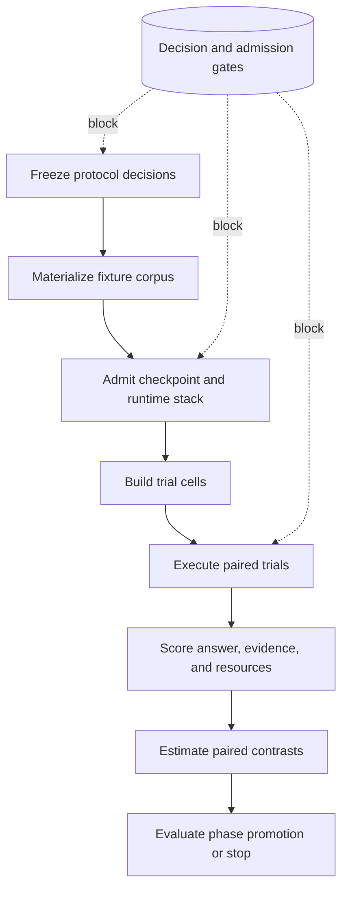

# High-Attention, Low-Parameter Experiment Protocol

## What This Module Owns

This module owns the contracts for constructing, admitting, executing, scoring,
and interpreting a resource-bounded comparison of how small language models use
long-context evidence. It separates presented tokens, KV-retained tokens,
retrieval-selected tokens, and successfully used evidence; it never treats an
advertised context length as a behavioral result.

The module does not own model training, checkpoint publication, GPU allocation,
canonical definitions, or a general claim about attention mechanisms. It cannot
authorize a run until the decision gates and runnable-witness obligations in
[Protocol readiness](#protocol-readiness) are materially closed.

## Module Map

## Capabilities

| Capability | What | Key Aspects | Detail |
| --- | --- | --- | --- |
| Protocol Governance | Freezes claim scope, estimands, matrix, thresholds, exclusions, and phase policy. | `FreezeProtocol`, `GetProtocolReadiness`, decision gates | [Operations](operations.md#freezeprotocol), [Queries](queries.md#getprotocolreadiness) |
| Fixture Materialization | Generates deterministic procedural fixtures, renders arms, and records provenance. | `MaterializeCorpus`, `RenderTrialCell`, fixture and render manifests | [Operations](operations.md#materializecorpus) |
| Stack Admission | Proves checkpoint/template/runtime compatibility and resident-KV feasibility without semantic overclaim. | `AdmitModelStack`, `CapacityWitness` | [Operations](operations.md#admitmodelstack) |
| Trial Execution | Executes blocked, paired cells with immutable inputs and complete run receipts. | `ExecuteTrialCell`, `RunReceipt` | [Operations](operations.md#executetrialcell) |
| Scoring And Inference | Scores answer and evidence separately and estimates frozen paired contrasts. | `ScoreTrial`, `AnalyzePhase` | [Operations](operations.md#scoretrial) |
| Budgeted Promotion | Preserves capability/resource axes and decides continue, narrow, pivot, or stop. | `EvaluatePhaseGate`, `GetResourceFrontier` | [Operations](operations.md#evaluatephasegate) |

## Domain Concepts

| Concept | Type | Key Constraints |
| --- | --- | --- |
| [ExperimentProtocol](domain.md#experimentprotocol) | Entity | Immutable after freeze; any material change creates a new protocol version. |
| [ProtocolDecision](domain.md#protocoldecision) | Entity | Records selection, alternatives, rationale, owner, and approval. |
| [FixtureInstance](domain.md#fixtureinstance) | Entity | Deterministically generated; family split and content hash are stable. |
| [PromptArm](domain.md#promptarm) | Value | Compact/full/absent/no-answer semantics cannot be conflated. |
| [TrialCell](domain.md#trialcell) | Entity | Exact factor tuple; no hidden retries or substitutions. |
| [ModelStack](domain.md#modelstack) | Entity | Immutable checkpoint, tokenizer, template, runtime, precision, and hardware identities. |
| [CapacityWitness](domain.md#capacitywitness) | Artifact | Proves exact fit and runtime behavior, not information use. |
| [RunReceipt](domain.md#runreceipt) | Artifact | Preserves inputs, outputs, timings, failures, and manifest handles. |
| [ScoreReceipt](domain.md#scorereceipt) | Artifact | Answer/evidence/false-support outcomes remain separately inspectable. |
| [AnalysisResult](domain.md#analysisresult) | Artifact | Uses frozen estimands and reports uncertainty and multiplicity handling. |
| [ResourceFrontier](domain.md#resourcefrontier) | Artifact | Named axes only; no primary composite winner score. |

## Concept Registry

| Concept | ID | Type |
| --- | --- | --- |
| [ExperimentProtocol](domain.md#experimentprotocol) | halp.ExperimentProtocol | Entity |
| [ProtocolDecision](domain.md#protocoldecision) | halp.ProtocolDecision | Entity |
| [FixtureInstance](domain.md#fixtureinstance) | halp.FixtureInstance | Entity |
| [PromptArm](domain.md#promptarm) | halp.PromptArm | Value |
| [TrialCell](domain.md#trialcell) | halp.TrialCell | Entity |
| [ModelStack](domain.md#modelstack) | halp.ModelStack | Entity |
| [CapacityWitness](domain.md#capacitywitness) | halp.CapacityWitness | Artifact |
| [RunReceipt](domain.md#runreceipt) | halp.RunReceipt | Artifact |
| [ScoreReceipt](domain.md#scorereceipt) | halp.ScoreReceipt | Artifact |
| [AnalysisResult](domain.md#analysisresult) | halp.AnalysisResult | Artifact |
| [ResourceFrontier](domain.md#resourcefrontier) | halp.ResourceFrontier | Artifact |
| [FreezeProtocol](operations.md#freezeprotocol) | halp.FreezeProtocol | Operation |
| [MaterializeCorpus](operations.md#materializecorpus) | halp.MaterializeCorpus | Operation |
| [AdmitModelStack](operations.md#admitmodelstack) | halp.AdmitModelStack | Operation |
| [ExecuteTrialCell](operations.md#executetrialcell) | halp.ExecuteTrialCell | Operation |
| [ScoreTrial](operations.md#scoretrial) | halp.ScoreTrial | Operation |
| [AnalyzePhase](operations.md#analyzephase) | halp.AnalyzePhase | Operation |
| [EvaluatePhaseGate](operations.md#evaluatephasegate) | halp.EvaluatePhaseGate | Operation |
| [GetProtocolReadiness](queries.md#getprotocolreadiness) | halp.GetProtocolReadiness | Query |
| [GetTrialMatrix](queries.md#gettrialmatrix) | halp.GetTrialMatrix | Query |
| [GetResourceFrontier](queries.md#getresourcefrontier) | halp.GetResourceFrontier | Query |
| [ProtocolLifecycle](states.md#protocollifecycle) | halp.ProtocolLifecycle | State |

## Feature Concept Graph

| From | Edge | To | Evidence | Notes |
| --- | --- | --- | --- | --- |
| halp.FreezeProtocol | produces | halp.ExperimentProtocol | [freeze operation](operations.md#freezeprotocol) | Frozen version only. |
| halp.MaterializeCorpus | produces | halp.FixtureInstance | [materialization](operations.md#materializecorpus) | Includes provenance. |
| halp.AdmitModelStack | produces | halp.CapacityWitness | [admission](operations.md#admitmodelstack) | Systems evidence only. |
| halp.ExecuteTrialCell | produces | halp.RunReceipt | [execution](operations.md#executetrialcell) | One receipt per attempt. |
| halp.ScoreTrial | produces | halp.ScoreReceipt | [scoring](operations.md#scoretrial) | Answer and evidence remain separate. |
| halp.AnalyzePhase | produces | halp.AnalysisResult | [analysis](operations.md#analyzephase) | Frozen analysis plan. |
| halp.GetResourceFrontier | queries | halp.ResourceFrontier | [frontier query](queries.md#getresourcefrontier) | No composite primary score. |
| halp.ProtocolInterface | exposes | halp.GetProtocolReadiness | [interfaces](interfaces.md#internal-protocol-interface) | Read-only readiness. |

## Normative Experiment Boundary

The first decision-bearing study is a within-family paired comparison of an
admitted small and larger checkpoint, initially targeting the Llama 1B/3B
family only when immutable revisions and their runtime stack pass admission.
Phi or another family is an external comparator, never a replicate. The study
supports checkpoint-specific and stack-specific comparative claims; it does not
support parameter causality or a general internal-attention mechanism claim.

The workload begins with procedural literal retrieval, two-hop tracing, and
contradiction fixtures. Identical semantic plans rotate evidence and decoys
through early, middle, and late positions. Required primary arms are compact
evidence-complete, full evidence-complete, evidence-absent, and no-answer.
Oracle-selection and retrieved-selection arms are deferred until their decision
purpose and accounting boundary are approved.

Full versus compact is a retention/non-inferiority comparison on the same
evidence, not a required positive improvement. Any claim that one checkpoint
uses long context better requires both the paired checkpoint contrast and a
difference-in-retention contrast. Added-evidence behavior is evidence-present
support plus evidence-absent abstention, not subtraction across incompatible
correct-answer semantics.

## Protocol Readiness

Execution is blocked until all of the following have immutable artifacts and
validation receipts:

1. Claim scope, primary outcome family, retention margin, checkpoint contrast,
   middle tolerance, false-support ceiling, multiplicity rule, sample size,
   allocation, and repetitions.
2. Versioned generator, provenance/license manifest, frozen splits, renderer,
   output grammar, deterministic scorer, and scorer-validation set.
3. Authorized checkpoint snapshots, tokenizer/template hashes, runtime image,
   backend and precision choices, hardware identity, and compatibility smoke.
4. Per-model and per-length resident-KV capacity witness proving no truncation,
   offload, preemption, fallback, recomputation, or hidden OOM recovery.
5. Retrieval role, energy/cost measurement boundary, frontier axes, failure
   taxonomy, raw-output retention, and manifest validator.
6. Explicit human approval of every decision recorded in
   [the gap ledger](work-pack/shared/cross-task-gaps.md).

Advertised 128K context is never an admission witness. A 128K trial remains
deferred until exact post-template fit and resident-KV evidence exist.

## Invariants

- No run consumes a draft or decision-gated protocol.
- No trial silently truncates, substitutes, retries, offloads, or changes its
  factor tuple.
- Every score traces to one immutable fixture, rendered prompt, raw output, and
  scorer version.
- Every systems claim names the exact model/runtime/hardware stack.
- Every behavioral claim names the workload, arm, position, length, and outcome.
- Capability, latency, memory, energy, cost, and parameters remain separate
  frontier axes.
- Failure and infeasibility are results; they are not silently dropped.

## Aspect Docs

| Aspect | Contains | Key Concepts |
| --- | --- | --- |
| [Glossary](GLOSSARY.md) | Feature-level terminology and source status | visible, retained, selected, used |
| [Domain](domain.md) | Entities, values, artifacts, and invariants | protocol, fixture, cell, receipts |
| [Operations](operations.md) | Write-side lifecycle contracts | freeze, materialize, admit, run, score, analyze |
| [Queries](queries.md) | Read-side projections | readiness, matrix, status, frontier |
| [Interfaces](interfaces.md) | File and command boundaries | artifact contracts, CLI surface |
| [States](states.md) | Protocol and trial lifecycles | decision-gated, admitted, runnable |
| [Events](events.md) | Audit events and consumers | frozen, admitted, completed, blocked |
| [Mappings](mappings.md) | Research-to-protocol and receipt transformations | evidence mapping, frontier mapping |

## Cross-Capability Dependencies

| Capability | Depends On | Via | Why |
| --- | --- | --- | --- |
| Protocol Governance | Invoke research findings | artifact handle | Preserve the accepted methodology and typed KILLs. |
| Trial Execution | `experiment-harness` | native capability handoff | Own repeatable experiment execution and receipts. |
| SWU Execution | `task-session` | one-SWU work-pack handoff | Build and validate bounded harness units. |
| Runtime Context | `context-builder` | execution-time handoff pack | Select strict source context for each SWU. |
| Observation | `signal-observer` | post-run envelope | Record capability use without promoting results. |

## Produces For

| Consumer | Consumes Capability | Via | What |
| --- | --- | --- | --- |
| Experiment owner | Protocol Governance | readiness query | Approved or blocked run posture. |
| Experiment Harness | Trial Execution | frozen manifests and trial cells | Repeatable model invocations and receipts. |
| Analysis reviewer | Scoring And Inference | score/analysis receipts | Claim-bounded comparative results. |
| Inventory | Budgeted Promotion | non-authority synthesis | Reusable result only after explicit backfill. |

## References

- [Auditor-approved protocol research](../experiment-protocol-research/findings.md)
- [Explorer evidence boundary](../experiment-protocol-research/research.md)
- [Prior experiment framing](../high-attention-low-parameter-models-research.md)
- [Architecture bundle](ARCHITECTURE-BUNDLE.md)
- [Implementation layering](IMPLEMENTATION-LAYERING.md)
- [Work-pack](WORK-PACK.md)
