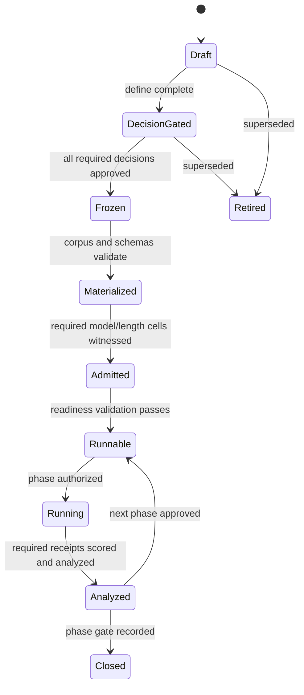

# State Machines: High-Attention, Low-Parameter Experiment Protocol

## ProtocolLifecycle

| From | Event | To | Guard | Effect |
| --- | --- | --- | --- | --- |
| Draft | DefineCompleted | DecisionGated | define validation passes | Publish unresolved decision ledger. |
| DecisionGated | ProtocolFrozen | Frozen | all approval-bearing decisions exist | Seal version/hash. |
| Frozen | CorpusMaterialized | Materialized | schemas, provenance, scorer fixtures pass | Admit corpus version. |
| Materialized | ModelStackAdmitted | Admitted | compatibility and capacity witnesses pass | Admit explicit cells only. |
| Admitted | ReadinessPassed | Runnable | no applicable closure item open | Allow phase authorization. |
| Runnable | PhaseStarted | Running | human/resource authorization | Queue exact cells. |
| Running | PhaseAnalyzed | Analyzed | eligibility and frozen analysis pass | Emit result and frontier. |
| Analyzed | PhaseClosed | Closed | stop/close decision recorded | Seal receipts. |
| Analyzed | NextPhaseApproved | Runnable | promotion evidence passes | Materialize next phase matrix. |

### Invariants

- No backward mutation of a frozen protocol; supersede with a new version.
- `Runnable` implies all applicable closure gates are closed.
- A phase cannot be both `Running` and `Closed`.
- A failed cell remains represented by a receipt.

## TrialLifecycle

`planned -> rendered -> admitted -> queued -> running -> completed | failed | aborted -> scored -> analysis_eligible | excluded`

Only a typed exclusion decision can move a completed/failed attempt out of the
confirmatory analysis set.
